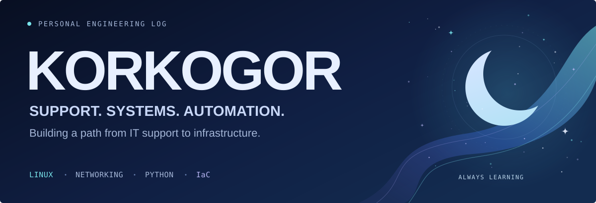

<!-- Korkogor | Personal GitHub profile | red + graphite -->

  

  
  &nbsp;
  

  <b>IT Support Engineer</b> &nbsp;→&nbsp; Infrastructure / DevOps / Cloud 
  Master's student in Computer Science and Engineering · Information Systems Architecture

## 01 / Profile

I work in IT support and am building the skills to move into infrastructure engineering. My current focus is Linux, networking and automation — understanding how systems work, troubleshooting problems and turning routine tasks into scripts.

Alongside my master's studies, I explore **Infrastructure as Code** and automated configuration management. **Unity and C#** are my creative outlet: small games, prototypes and learning through practice.

## 02 / Toolkit

### Systems & scripting

  
  
  
  
  
  

**Practical foundation:** Windows administration, Active Directory, PowerShell and IT troubleshooting.  
**Learning & practice:** Linux, networking, Python, Git and GitHub.

### Data & forecasting

  
  
  
  
  

  
  
  
  
  
  
  

Academic coursework in data analysis, time series forecasting and reproducible Python notebooks.

### Game development

  
  

Unity & C# — small games, prototypes and gameplay experiments.

<b>Time series & forecasting — coursework details</b>

 

Exploring classical forecasting and neural networks through reproducible Python notebooks.

- **Analysis & visualization:** Pandas, NumPy, Matplotlib.
- **Classical forecasting:** Statsmodels, ARIMA.
- **Neural forecasting:** PyTorch, LSTM, NeuralForecast, NHITS, NBEATS.
- **Additional forecasting tools:** Prophet.

## 03 / Learning path

**Infrastructure Engineering → DevOps → Cloud & Platform Engineering**

  
  
  
  
  

*Planned tools for automation, infrastructure and platform engineering.*

| Stage | Focus | Status |
| :--- | :--- | :---: |
| **Foundations** | Linux administration, networking, Python, Git |  |
| **Automation & delivery** | Bash, Docker, CI/CD, Ansible |  |
| **Infrastructure as Code** | Terraform, repeatable provisioning, configuration management |  |
| **Platform operations** | Kubernetes, cloud infrastructure, observability |  |

## 04 / Research & projects

### Infrastructure automation

My academic research focuses on **Infrastructure as Code and automated management of server configuration state**. I am studying information systems architecture and preparing research papers on infrastructure automation.

### Python & forecasting

Console applications and coursework projects: strings, lists, dictionaries, input validation and search logic. Academic notebooks explore data analysis, forecasting and reproducible experiments.

[Explore repositories →](https://github.com/Korkogor?tab=repositories)

### Unity & C#

Small game prototypes and gameplay experiments. A place to practice C#, try mechanics and build something playable.

[Browse game development work →](https://github.com/Korkogor?tab=repositories)

 

  

